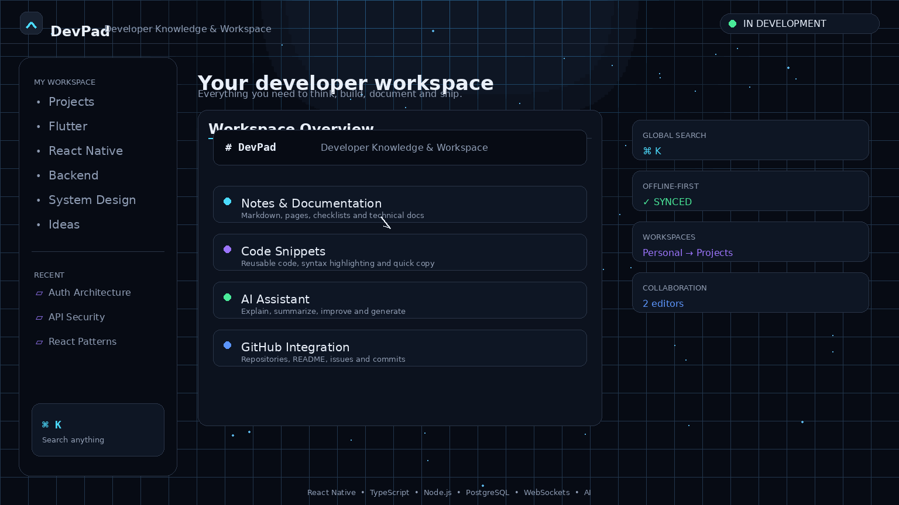

<div align="center">



</div>
<div align="center">

# DevPad

**Think. Plan. Build.**

A dark, developer-first workspace for ideas, notes, code, diagrams and tasks.
One login, the same workspace on your phone, browser and desktop.


</div>

---

## Table of contents

- [Overview](#overview)
- [Features](#features)
- [Screenshots](#screenshots)
- [Tech stack](#tech-stack)
- [Architecture](#architecture)
- [Data model](#data-model)
- [Security](#security)
- [Getting started](#getting-started)
- [Configuration](#configuration)
- [Keyboard shortcuts](#keyboard-shortcuts)
- [Testing](#testing)
- [Project status and roadmap](#project-status-and-roadmap)
- [Known limitations](#known-limitations)
- [Contributing](#contributing)
- [License](#license)

---

## Overview

DevPad is a cross-platform workspace built for developers. Instead of scattering
ideas across notes apps, whiteboards, snippet files and to-do lists, you create
**Pads**, one per project or idea, and keep everything for it in one place:

| Section  | What it holds                                              |
| -------- | ---------------------------------------------------------- |
| Overview | Pad details and status                                     |
| Notes    | Markdown notes with autosave and live preview              |
| Canvas   | Excalidraw-style canvas for architecture and flow diagrams |
| Code     | Snippets with language selection and syntax highlighting   |
| Tasks    | To do / In progress / Done with priority and due dates     |
| Links    | Docs, repos and references, grouped by category            |
| Files    | Images and PDFs (temporary, 7-day retention)               |

The interface is designed to feel like a developer tool rather than a generic
CRUD app: dark theme, thin borders, monospace accents, keyboard shortcuts and
a layout that adapts from phone to desktop.

## Features

**Workspace**
- Create, rename, archive, restore, delete and search Pads
- Recent Pads on the home screen
- Section state lives in the URL (`/pads/<id>?section=notes&note=<id>`), so
  refresh, back button and bookmarks work

**Notes**
- Markdown editor with formatting toolbar and `Ctrl+B` / `Ctrl+I`
- Edit and preview modes, tappable links
- Autosave (800 ms debounce), search, last-edited timestamp

**Code snippets**
- 22 languages, syntax highlighting in view mode
- Copy button, `Tab` inserts two spaces, search by title, code or language

**Tasks**
- Status, priority, due date, overdue indicator
- Quick add (type and press Enter) plus a full edit dialog
- Filter by status and priority, automatic sorting

**Links**
- URL normalization (`flutter.dev` becomes `https://flutter.dev`), http/https only
- Categories, filtering, open, copy and edit

**Canvas**
- Tools: select, pan, rectangle, circle, arrow, line, text, pen, eraser
- Pan and zoom (wheel, `Ctrl`+wheel, pinch, space-drag), fit to content
- Move, resize, recolor, delete, undo and redo
- Autosave and reload

**Files**
- Upload images (PNG, JPG, GIF, WebP) and PDFs up to 5 MB
- Thumbnails, open, copy link, delete
- Automatic cleanup of files older than 7 days

**Offline and sync**
- Firestore local cache: previously opened data is readable offline
- Edits made offline are queued and sync on reconnect
- Sync status banner (offline / N changes waiting / syncing)
- Editors follow remote changes; if you have unsaved edits that conflict you
  choose **Keep mine**, **Use theirs** or **Keep both**

**Auth**
- Email and password, Google Sign-In, password reset
- Session persistence and route guarding

**Responsive**
- Desktop: sidebar, Pad explorer and workspace
- Tablet: compact navigation rail
- Mobile: bottom navigation bar


## Tech stack

| Layer            | Choice                                                    |
| ---------------- | --------------------------------------------------------- |
| UI               | Flutter, Material 3, custom dark design system            |
| State            | Riverpod                                                  |
| Routing          | go_router (`StatefulShellRoute`)                          |
| Auth             | Firebase Authentication                                   |
| Database         | Cloud Firestore (with offline persistence)                |
| File storage     | Supabase Storage (REST, no SDK)                           |
| Markdown         | flutter_markdown_plus                                     |
| Syntax highlight | highlight                                                 |
| Misc             | url_launcher, file_picker, http                           |

Dependencies are added only when a feature needs them. Features that Flutter
already provides (date picker, drawing, responsive layout) use built-in widgets.

## Architecture

Feature-first with clean architecture layers. The UI never talks to Firebase
directly: widgets use Riverpod providers, providers use repositories, and only
the data layer imports a backend SDK. Replacing Firebase later means
re-implementing the repository classes, not rewriting the UI.

```text
lib/
├── app/                  # app widget, router, theme, adaptive shell
├── core/                 # shared widgets, utils, errors, services, config
├── features/
│   ├── auth/             # login, signup, reset, Google
│   ├── home/             # dashboard shell and roadmap
│   ├── pads/             # pad CRUD, workspace, section navigation
│   ├── notes/
│   ├── snippets/
│   ├── tasks/
│   ├── links/
│   ├── canvas/
│   └── files/
└── main.dart

features/<name>/
├── domain/               # entities, repository contracts, pure logic
├── data/                 # Firestore/REST datasources, models, repository impls
└── presentation/         # providers, screens, widgets
```

Design decisions worth knowing:

- **Canvas logic is UI-framework-light.** `CanvasController` holds elements,
  undo/redo, tools and viewport with no Firebase or Riverpod, so it is unit
  tested directly. Painting uses `CustomPainter`; input uses raw pointer events
  so one finger draws and two fingers pinch.
- **Offline writes do not block the UI.** Firestore writes only resolve once
  the server confirms them. Datasources stop waiting after 5 seconds, treat the
  write as queued and track it for the sync banner. Real errors such as
  `permission-denied` still surface immediately.
- **Errors are presentable.** The data layer converts SDK exceptions into
  `AppFailure` messages; every feature handles loading, empty and error states.

## Data model

```text
pads/{padId}
  ownerId, title, description, icon, archived,
  createdAt, updatedAt, lastOpenedAt
  ├── notes/{noteId}        title, content, createdAt, updatedAt
  ├── snippets/{snippetId}  title, language, code, createdAt, updatedAt
  ├── tasks/{taskId}        title, description, status, priority, dueDate, ...
  ├── links/{linkId}        title, url, description, category, ...
  ├── canvas/main           elements (JSON string), version, updatedAt
  └── files/{fileId}        name, size, contentType, path, createdAt, expiresAt
```

Ownership is stored once, on the Pad. Sub-collections carry no `ownerId`;
rules check the parent Pad. Deleting a Pad also deletes its sub-collections
(Firestore does not do this automatically) and its uploaded files.

## Security

- **Firestore rules** (`firestore.rules`): a signed-in user can only read and
  write Pads they own, and everything under them. Every document type is
  validated (field whitelist, types, size limits, allowed enum values).
  `ownerId` and `createdAt` cannot be changed. Link URLs must be http(s).
  Everything not explicitly allowed is denied.
- **No secrets in source.** Storage keys are passed at build time with
  `--dart-define-from-file=env.json`, which is git-ignored. Firebase client
  config in `firebase_options.dart` consists of public identifiers; access
  control comes from Auth and the rules above.
- **Never ship a Supabase secret key** in the app. Only the publishable (anon)
  key is used.

> **File storage caveat:** the Supabase bucket is public and file names are
> random. Anyone with a file link can open it, and because the publishable key
> ships with the app, uploads are limited only by bucket settings (5 MB,
> images and PDFs). This is suitable for personal use, not for sensitive
> documents. See [Roadmap](#project-status-and-roadmap).

## Getting started

### Prerequisites

- Flutter SDK (stable) with Dart 3
- A Firebase project (Authentication and Firestore enabled)
- Node.js, for the Firebase CLI
- Optional: a Supabase project, for the Files section
- Windows desktop builds need Visual Studio with the C++ workload

### 1. Clone and install

```bash
git clone https://github.com/shikhar11x/devpad.git
cd devpad
flutter pub get
```

### 2. Firebase

```bash
npm install -g firebase-tools
firebase login
dart pub global activate flutterfire_cli
flutterfire configure --project=devpad.xi --platforms=android,web,windows
```

In the Firebase console:

1. **Authentication → Sign-in method:** enable Email/Password and Google.
2. **Firestore Database:** create a database in production mode (the location
   cannot be changed later).
3. For Google Sign-In on Android, add your debug SHA-1 under
   **Project settings → Your apps → Add fingerprint**, then re-run
   `flutterfire configure`.

Make sure `firebase.json` contains:

```json
{
  "firestore": { "rules": "firestore.rules" }
}
```

Deploy the rules:

```bash
firebase deploy --only firestore:rules --project <your-project-id>
```

### 3. Supabase (optional, for Files)

1. Create a project and a **public** bucket named `devpad-files`
   (file size limit 5 MB; allowed types: PNG, JPEG, GIF, WebP, PDF).
2. Run in the SQL editor:

```sql
create policy "devpad insert" on storage.objects
  for insert to anon, authenticated
  with check (bucket_id = 'devpad-files');

create policy "devpad select" on storage.objects
  for select to anon, authenticated
  using (bucket_id = 'devpad-files');

create policy "devpad delete" on storage.objects
  for delete to anon, authenticated
  using (bucket_id = 'devpad-files');
```

Without Supabase configured the app still runs; the Files tab shows a
"storage is not set up" message.

### 4. Run

```bash
flutter run -d chrome --dart-define-from-file=env.json   # web
flutter run --dart-define-from-file=env.json             # Android device/emulator
flutter run -d windows --dart-define-from-file=env.json  # Windows (no Google Sign-In yet)
```

## Configuration

Create `env.json` in the project root (it is git-ignored):

```json
{
  "SUPABASE_URL": "https://<project-ref>.supabase.co",
  "SUPABASE_ANON_KEY": "<publishable key>",
  "SUPABASE_BUCKET": "devpad-files"
}
```

Use the **publishable** key (`sb_publishable_...`), never the secret key.

Android notes: `minSdk` must be at least 23, and `AndroidManifest.xml` needs
the `https` VIEW intent inside `<queries>` so links can open on Android 11+.

## Keyboard shortcuts

| Where  | Shortcut                                           | Action                  |
| ------ | -------------------------------------------------- | ----------------------- |
| Notes  | `Ctrl+B` / `Ctrl+I`                                | Bold / italic           |
| Notes, Code, Canvas | `Ctrl+S`                              | Save now                |
| Code   | `Tab`                                              | Insert two spaces       |
| Canvas | `V` `H` `R` `O` `A` `L` `T` `P` `E`                | Switch tool             |
| Canvas | `Ctrl+Z` / `Ctrl+Y` or `Ctrl+Shift+Z`              | Undo / redo             |
| Canvas | `Delete` / `Backspace`, `Esc`                      | Delete / deselect       |
| Canvas | Wheel, `Ctrl`+wheel, `Space`+drag, pinch           | Pan / zoom              |

(`Cmd` replaces `Ctrl` on macOS.)

## Testing

```bash
flutter analyze
flutter test
```

Unit tests cover the Markdown formatter, code highlighter, canvas controller
and codec, task and link filtering, URL normalization, file rules and offline
helpers. Widget tests run the real app with auth and data providers replaced
by fakes, so they need no Firebase connection. Behaviour that depends on a
live backend (rules, offline sync, uploads) is verified manually.

## Project status and roadmap

| Stage | Feature                         | Status      |
| ----- | ------------------------------- | ----------- |
| 0     | Foundation, theme, responsive shell | Done    |
| 1     | Authentication                  | Done        |
| 2     | Pad management                  | Done        |
| 3     | Pad workspace                   | Done        |
| 4     | Notes                           | Done        |
| 5     | Code snippets                   | Done        |
| 6     | Tasks                           | Done        |
| 7     | Links and resources             | Done        |
| 8     | Files (Supabase, 7-day retention) | Done      |
| 9     | Canvas                          | Done        |
| 10    | Offline support and conflicts   | Done        |
| 11    | Sharing: Owner, Editor, Viewer  | Planned     |
| 12    | GitHub integration              | Planned     |
| 13    | AI assistant                    | Planned     |
| 14    | Public Pads / portfolio         | Planned     |

Possible follow-ups: private file storage tied to Firebase identity,
server-side file expiry, real-time collaboration, canvas multi-select and
export, a custom backend behind the existing repository interfaces.

## Known limitations

- **Concurrent edits:** the conflict dialog appears for Notes and Snippets
  when you are online with the editor open. If you edit offline and the item
  changes elsewhere meanwhile, your queued write wins on reconnect (last write
  wins). Tasks, Links and Canvas also use last write wins.
- **Files** are temporary (7 days), public by link, need a connection to
  upload, and expired files are cleaned up when someone opens the Files tab.
- **Offline cache** only contains data you opened before. On web, only the
  first open tab gets persistent cache.
- **Deleting a Pad** requires a connection, by design, to avoid orphaned data.
- **Google Sign-In** is not supported on Windows desktop yet.
- Syntax highlighting appears in view mode, not while typing.
- Canvas is stored as a single document (about 800 KB limit).

## Contributing

Issues and pull requests are welcome. Please keep changes feature-scoped,
run `flutter analyze` and `flutter test` before opening a PR, and use
conventional commit messages (`feat:`, `fix:`, `docs:`, `refactor:`).

## License

`MIT © <shikhar11x>`.

---

<div align="center">
Built with Flutter. <strong>Think. Plan. Build.</strong>
</div>
